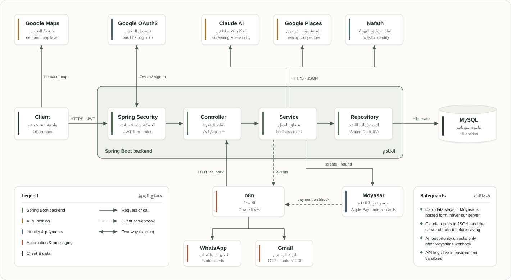

<div align="center">


**Neighborhood demand platform powered by AI**

منصة يطلب فيها سكان الحي المحلات والخدمات اللي تنقصهم، ويستخدم المستثمرون هذا الطلب الموثّق لفتح المشروع في المكان الصح


</div>

---

Naseej lets neighborhood residents request the shops and services they're missing, and investors use that verified demand to choose the right project and location. AI screens every idea before it goes live, residents join for free as founding members, and investors unlock completed requests with a one-time fee or a success partnership. The pilot starts in Riyadh neighborhoods.

## 📑 Table of Contents

- [Features](#-features)
- [Tech Stack](#️-tech-stack)
- [Integrations](#-integrations)
- [n8n Workflows](#️-n8n-workflows)
- [Architecture](#️-architecture)
- [How Idea Screening Works](#-how-idea-screening-works)
- [Use Case Diagram](#use-case-diagram)
- [Class Diagram](#class-diagram)
- [Authentication & Roles](#-authentication--roles)
- [Revenue Model](#-revenue-model)
- [Project Structure](#-project-structure)
- [Getting Started](#-getting-started)
- [Team](#-team)
- [Endpoints](#-endpoints)
- [Contact](#-contact)

## ✨ Features

- **Residents** post requests by text or voice in their own dialect, join existing requests for free as founding members, and see demand on a neighborhood map. A member counts only after email and residence verification.
- **Idea owners** get AI screening before publishing and an AI-drafted business model they can edit by chat.
- **Investors** search by neighborhood, capital or project name, read a short AI feasibility study, unlock opportunities through Moyasar or a success partnership, and sign contracts inside the platform.
- **Landlords** list vacant shops that appear inside nearby opportunities.
- **Everyone** gets WhatsApp and email alerts when a request completes, an idea is adopted or a business opens.

## 🛠️ Tech Stack

| Layer | Technology |
|---|---|
| Backend | Java 17+, Spring Boot 3, Spring Data JPA, Jakarta Validation, Lombok |
| Security | Spring Security, JWT (access + refresh), Google OAuth2, BCrypt |
| Database | MySQL |
| Tools | n8n, Postman, Git & GitHub |

## 🔌 Integrations

| Service | Used for | How we integrated it |
|---|---|---|
|  **Claude AI** | Request understanding, Idea Screening, Business Model, Feasibility Study | The server sends the idea, Google Places results and nearby published ideas to Claude. Every response comes back as JSON and is validated by the server before it is saved. |
|  **Google Places API** | Scarcity check, competitors | Finds businesses of the same type within a radius that fits the activity, then calculates the count and nearest competitor and compares them with the city average. |
|  **Google Maps** | Demand map | Shows neighborhoods colored by the number of votes for each activity. |
|  **Google OAuth2** | Sign-in | `oauth2Login()` signs the user in. New users are created with the `PENDING` role, sent to the membership page, then issued a JWT. |
| 💳 **Moyasar** | Payments and refunds | Moyasar's ready payment form handles Apple Pay, mada and cards, so card data never reaches our server. An opportunity is unlocked only after Moyasar's webhook confirms the payment, and refunds go through the Refund API. |
|  **n8n** | Automation | Spring Boot and Moyasar trigger n8n workflows through webhooks for screening, alerts, contracts, deadlines and digests. |
|  **WhatsApp** | Alerts | Sent by n8n: request completed, idea adopted, contract ready to sign, business opened. |
|  **Gmail** | OTP codes and contracts | Connected in n8n through an OAuth2 credential from the platform's official account, so emails arrive from "Naseej" and not from a person. |
| 🪪 **Nafath** | Investor verification | Investors must verify their identity through Nafath before they can access opportunities. |

Every AI result is validated by the server before it is stored or used in any payment step, and nothing is unlocked for an investor before Moyasar's webhook arrives. Moyasar keys are kept in environment variables.

## ⚙️ n8n Workflows

| Workflow | Trigger | Action |
|---|---|---|
| New idea | App webhook | Screen the idea and notify interested neighbors |
| Request completed | Vote threshold reached | Generate the feasibility study and alert investors |
| Payment confirmed | Moyasar webhook | Unlock the opportunity and issue the VAT invoice |
| Adoption follow-up | Investor adopts | Collect signatures, email the contract PDF, follow up every 2 weeks |
| Adoption expired | 90 days without opening | Reopen the opportunity and update founding members |
| Email OTP | Sign-up or login | Send the 6-digit code through Gmail |
| Weekly digest | Every Sunday | Send investors the top rising requests |

## 🏗️ Architecture

<p align="center">
  <a href="assets/docs/ArchitectureDiagram.svg">
    
  </a>
</p>

## 🔍 How Idea Screening Works

Before an idea is published, Claude extracts the activity and neighborhood, Google Places counts competitors within a radius that fits the activity (1 km for a supermarket, 3 km for a gym), and a semantic check looks for similar ideas nearby. The result is a score out of 100 and one decision:

| Decision | Meaning | Next step |
|---|---|---|
| `SUITABLE` | Clear gap, no matching idea | Build the business model, then publish |
| `SIMILAR_EXISTS` | A close idea is posted nearby | Join it, or publish and explain the difference |
| `SATURATED` | Competitors well above the city average | Suggest a scarcer activity in the same neighborhood |

## Use Case Diagram

<p align="center">
  <a href="assets/docs/UseCaseDiagram.svg">
    
  </a>
</p>

## Class Diagram

<p align="center">
  <a href="assets/docs/ClassDiagram.svg">
    
  </a>
</p>

## 🔐 Authentication & Roles

Login is stateless with JWT access and refresh tokens. Users sign up with Google or with email and password; email accounts verify with a 6-digit OTP (valid 5 minutes, locked after 5 wrong attempts), and investors verify with Nafath before accessing opportunities. All endpoints start with `/v1/api`, only sign-up and login are public, and role-specific actions are protected with `@PreAuthorize`.

| Role | Can |
|---|---|
| `PENDING` | Google user before choosing a membership |
| `RESIDENT` | Post ideas, join as a founding member, sign as idea owner |
| `INVESTOR` | Search, unlock and adopt opportunities, sign contracts |
| `LANDLORD` | List vacant shops |
| `ADMIN` | Manage users and opportunities, receive a copy of every contract |

## 💰 Revenue Model

Residents and idea owners use Naseej for free. Prices below are proposals for testing with the first investors.

| Source | Who pays | Proposed price |
|---|---|---|
| Opportunity access fee | Investor | 1,500 SAR + VAT per opportunity |
| Success partnership | Investor who doesn't pay upfront | 5% of net profit for 3 years after opening |
| Investor subscription | Active investors | 299 or 999 SAR per month |
| Vacant shop listing | Landlords | 199 SAR per month per shop |

## 📁 Project Structure

```
com.example.naseej
├── Api          # ApiException and ApiResponse
├── Config       # Security, OAuth2 and external service configs
├── Controller   # REST endpoints
├── DTOIN        # Request bodies with validation
├── DTOOUT       # Response bodies
├── Enums        # Role, IdeaStatus, ContractStatus and other enums
├── Entity        # JPA entities
├── Repository   # Database access
├── Security     # JwtAuthenticationFilter, AuthenticationSuccessHandler
└── Service      # Business logic
```

## 🚀 Getting Started

1. Clone the repository: `git clone https://github.com/<your-org>/Naseej.git`
2. Create a MySQL database and set the connection details in `src/main/resources/application.properties`.
3. Add the API keys as environment variables (below).
4. Import the n8n workflows and add a Gmail OAuth2 credential from the platform's official account.
5. Run `./mvnw spring-boot:run`. Use Moyasar's test keys and test cards during development.

<details>
<summary>Environment variables</summary>

```properties
claude.api.key=${CLAUDE_API_KEY}
claude.model=${CLAUDE_MODEL}
google.places.api.key=${GOOGLE_PLACES_API_KEY}
spring.security.oauth2.client.registration.google.client-id=${GOOGLE_CLIENT_ID}
spring.security.oauth2.client.registration.google.client-secret=${GOOGLE_CLIENT_SECRET}
jwt.secret=${JWT_SECRET}
moyasar.secret.key=${MOYASAR_SECRET_KEY}
moyasar.publishable.key=${MOYASAR_PUBLISHABLE_KEY}
n8n.webhook.url=${N8N_WEBHOOK_URL}
```

</details>

<details>
<summary>Test accounts (development only)</summary>

| Role | Email | Password | Notes |
|---|---|---|---|
| Admin | `TODO` | `TODO` | Receives a copy of every contract |
| Resident | `TODO` | `TODO` | Residence verified, owns an idea |
| Resident | `TODO` | `TODO` | Founding member of that idea |
| Investor | `TODO` | `TODO` | Nafath verified |
| Investor | `TODO` | `TODO` | Not verified, can't access opportunities |
| Landlord | `TODO` | `TODO` | Has a vacant shop listed |

</details>

## 👥 Team

<table>
  <tr>
    <td align="center" width="33%">
      <a href="https://github.com/AHMEDALHAMAMI"><br><b>Ahmad Alhamami</b></a><br>
      <sub> AI feature</sub><br><br>
      Responsibilities<br><br>
      <b>0</b> extra endpoints
    </td>
    <td align="center" width="33%">
      <a href="https://github.com/WaleedAlaql"><br><b>Waleed Alaql</b></a><br>
      <sub> AI feature</sub><br><br>
      Responsibilities<br><br>
      <b>0</b> extra endpoints
    </td>
    <td align="center" width="33%">
      <a href="https://github.com/AmiraAldajani"><br><b>Amira Aldajani</b></a><br>
      <sub> AI feature</sub><br><br>
      Responsibilities<br><br>
      <b>0</b> extra endpoints
    </td>
  </tr>
</table>

## 🧩 Endpoints


<details open>
<summary>&nbsp;<b>Authentication</b> (7)</summary>

| Method | Endpoint | Description |
|---|---|---|
| `POST` | `/v1/api/auth/register` | Sign up with email, password, name, neighborhood, mobile and membership type |
| `POST` | `/v1/api/auth/verify-otp` | Verify the 6-digit email code |
| `POST` | `/v1/api/auth/login` | Log in and get access and refresh tokens |
| `POST` | `/v1/api/auth/refresh` | Get a new access token from the refresh token |
| `POST` | `/v1/api/auth/logout` | Log out |
| `GET` | `/oauth2/authorization/google` | Start Google sign-in |
| `PUT` | `/v1/api/auth/select-role` | Choose resident or investor after Google sign-in |

</details>

<!-- Add one <details> block per team member with their endpoints, in the same format as Authentication above -->

## 📬 Contact

<table>
  <tr>
    <td align="center" width="33%">
      <a href="https://www.linkedin.com/in/ahmedalhamami"><br><b>Ahmad Alhamami</b></a><br><br>
      <a href="https://www.linkedin.com/in/ahmedalhamami"></a>
    </td>
    <td align="center" width="33%">
      <a href="https://www.linkedin.com/in/waleed-alaql"><br><b>Waleed Alaql</b></a><br><br>
      <a href="https://www.linkedin.com/in/waleed-alaql"></a>
    </td>
    <td align="center" width="33%">
      <a href="https://www.linkedin.com/in/amira-aldajani-2b0296222/"><br><b>Amira Aldajani</b></a><br><br>
      <a href="https://www.linkedin.com/in/amira-aldajani-2b0296222/"></a>
    </td>
  </tr>
</table>
